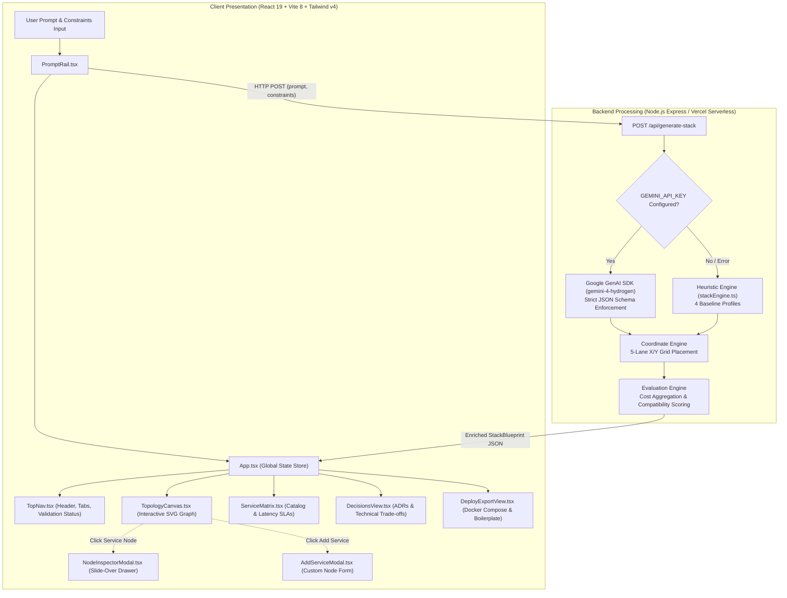
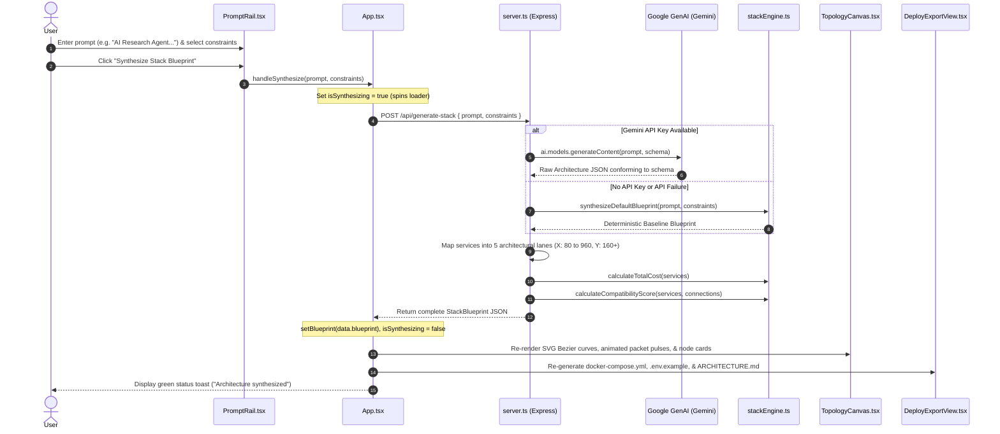
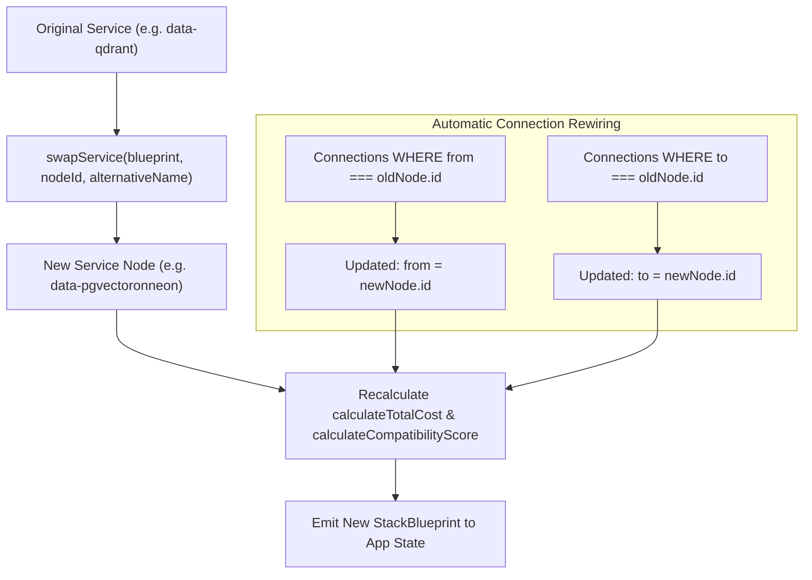

# IdeaToStack — Deep Technical Architecture & Project Guide

Welcome to the comprehensive technical guide for **IdeaToStack**. This document provides an exhaustive, file-by-file walkthrough of the entire system: how data flows, how state is managed, how the backend synthesizes architectures with Gemini AI and deterministic engines, how the SVG topology canvas renders animated connection wires, and how deployment manifests are generated.

---

## Table of Contents

1. [High-Level Architectural Overview](#1-high-level-architectural-overview)
2. [End-to-End Data & Execution Lifecycle](#2-end-to-end-data--execution-lifecycle)
3. [File-by-File Deep Dive](#3-file-by-file-deep-dive)
   * [Root & Server Infrastructure](#root--server-infrastructure)
   * [Core Application & State Orchestration](#core-application--state-orchestration)
   * [The Architectural Engine (`src/utils/`)](#the-architectural-engine-srcutils)
   * [User Interface Components (`src/components/`)](#user-interface-components-srccomponents)
4. [Under the Hood: Core Algorithms & Logic](#4-under-the-hood-core-algorithms--logic)
   * [Dual-Engine Synthesis (Gemini AI vs. Deterministic Heuristic)](#dual-engine-synthesis-gemini-ai-vs-deterministic-heuristic)
   * [Automated 2D Canvas Coordinate Layout Engine](#automated-2d-canvas-coordinate-layout-engine)
   * [Architectural Compatibility & Cohesion Scoring](#architectural-compatibility--cohesion-scoring)
   * [In-Place Service Hot-Swapping & Graph Rewiring](#in-place-service-hot-swapping--graph-rewiring)
   * [Dynamic Code Generation (Docker Compose, `.env`, ADRs)](#dynamic-code-generation-docker-compose-env-adrs)
5. [Deployment Architecture (Local vs. Vercel Serverless)](#5-deployment-architecture-local-vs-vercel-serverless)
6. [Data Schema & Type Contracts](#6-data-schema--type-contracts)

---

## 1. High-Level Architectural Overview

IdeaToStack transforms natural language product concepts into production-grade cloud architectures, interactive topology graphs, Architecture Decision Records (ADRs), and deployable Docker Compose boilerplate.

### System Architecture Diagram



---

## 2. End-to-End Data & Execution Lifecycle

Here is what happens step by step when you enter a prompt and synthesize an architecture:



---

## 3. File-by-File Deep Dive

### Root & Server Infrastructure

#### 1. [server.ts](file:///d:/IdeaToStack/server.ts)
* **Role**: Primary backend Express application and API routing server.
* **Key Functionality**:
  * **SDK Initialization**: Initializes `GoogleGenAI` from `@google/genai` using `process.env.GEMINI_API_KEY`. It passes a custom telemetry header `'User-Agent': 'aistudio-build'`.
  * **Route: `GET /api/health`** (and `/health`): Returns server health status, ISO timestamp, and a boolean `geminiConfigured` confirming whether an API key is active.
  * **Route: `POST /api/generate-stack`** (and `/generate-stack`):
    1. Validates incoming natural language prompt string and optional constraints (`hosting`, `language`, `budgetTier`, `scalability`).
    2. Calls Gemini AI with a strict JSON schema defining `title`, `tagline`, `estimatedLatencyMs`, `services` (array of node objects), `connections` (array of edge objects), and `decisions` (array of ADR objects).
    3. If no key is set or the AI call throws an error, it gracefully falls back to `synthesizeDefaultBlueprint` from `stackEngine.ts`.
    4. Calculates 2D canvas coordinates using the 5-lane layout system.
    5. Calculates aggregate monthly cost and compatibility report before returning the complete `StackBlueprint` JSON.
  * **Vite Integration**: In development, boots Vite in middleware mode (`createServer({ server: { middlewareMode: true } })`) so frontend changes hot-reload seamlessly. In production, serves static files from `dist/`.
  * **Serverless Export**: Exports `app` and skips `app.listen(3000)` when running in serverless environments (`process.env.VERCEL`).

#### 2. [api/index.ts](file:///d:/IdeaToStack/api/index.ts)
* **Role**: Vercel Serverless Function entry point.
* **Key Functionality**:
  * Imports the configured Express `app` from `../server` and exports it as the default handler.
  * Allows Vercel to route any incoming `/api/*` request directly through the Express routing pipeline as an on-demand serverless function.

#### 3. [vercel.json](file:///d:/IdeaToStack/vercel.json)
* **Role**: Vercel deployment and routing configuration.
* **Key Functionality**:
  * Defines build command (`npm run build`), output directory (`dist`), and framework preset (`vite`).
  * Establishes clean URL rewrites:
    * `/api/(.*)` $\rightarrow$ routes to the serverless function `/api`.
    * `/((?!api/|assets/|favicon.ico).*)` $\rightarrow$ routes all frontend routes to `/index.html` to support client-side Single Page Application (SPA) navigation without 404 errors.

#### 4. [.npmrc](file:///d:/IdeaToStack/.npmrc)
* **Role**: NPM package manager configuration.
* **Key Functionality**: Sets `legacy-peer-deps=true`. This guarantees that automated CI/CD pipelines (like Vercel and GitHub Actions) can cleanly install dependencies despite React 19 peer-dependency constraints in third-party libraries.

#### 5. [vite.config.ts](file:///d:/IdeaToStack/vite.config.ts)
* **Role**: Vite bundler build pipeline configuration.
* **Key Functionality**:
  * Registers `@vitejs/plugin-react` for React 19 JSX compilation and fast refresh.
  * Registers `@tailwindcss/vite` (Tailwind CSS v4 compiler plugin).
  * Configures path alias `@` to resolve to the project root directory using `import.meta.dirname`.
  * Supports `DISABLE_HMR` environment toggle to disable file watchers during programmatic code modifications.

#### 6. [tsconfig.json](file:///d:/IdeaToStack/tsconfig.json)
* **Role**: TypeScript compiler configuration.
* **Key Functionality**:
  * Targets modern `ES2022` with `moduleResolution: "bundler"`.
  * Enables React 19 JSX transformation (`"jsx": "react-jsx"`).
  * Enables path mapping (`"@/*": ["./*"]`).
  * Enforces type-safety without emitting standalone JS files (`"noEmit": true`) since Vite and TSX handle bundling.

#### 7. [index.html](file:///d:/IdeaToStack/index.html)
* **Role**: HTML5 entry document.
* **Key Functionality**:
  * Preconnects to Google Fonts and imports the project's typography triad:
    * **Geist**: Technical headlines, framework titles, card titles.
    * **Inter**: High-legibility UI body text, architectural rationales, forms.
    * **JetBrains Mono**: Terminal code snippets, environment tokens, latency badges, Docker images.
  * Sets the root DOM mount target (`<div id="root"></div>`) and links to `src/main.tsx`.

---

### Core Application & State Orchestration

#### 8. [src/main.tsx](file:///d:/IdeaToStack/src/main.tsx)
* **Role**: React application bootstrapping.
* **Key Functionality**: Uses React 19's `createRoot(document.getElementById('root')!)` to mount `<App />` and loads global styles from `src/index.css`.

#### 9. [src/App.tsx](file:///d:/IdeaToStack/src/App.tsx)
* **Role**: Root application container and global state coordinator.
* **State Managed**:
  * `blueprint` (`StackBlueprint`): The complete active architecture definition (services, connections, ADRs, costs, scores). Initialized with the *Real-time collaborative whiteboard* preset.
  * `activeTab` (`'canvas' | 'matrix' | 'decisions' | 'deploy'`): Controls which primary view is mounted.
  * `selectedNode` (`StackServiceNode | null`): Currently selected service node for inspection in the slide-over drawer.
  * `isSynthesizing` (`boolean`): Loading state during Gemini AI or heuristic blueprint synthesis.
  * `isAddModalOpen` (`boolean`): Visibility toggle for the custom node provisioning modal.
  * `toastMessage` (`string | null`): Auto-dismissing notification toast shown at the bottom of the screen.
* **Key Handlers**:
  * `handleSynthesize(prompt, constraints)`: Sends a `POST` request to `/api/generate-stack`. If the backend is unavailable or errors out, it falls back to the client-side `synthesizeDefaultBlueprint` and updates state.
  * `handleSwapService(nodeId, alternativeName)`: Calls `swapService(...)` from `stackEngine.ts`, replacing a service, remapping its connections, and recalculating budget and compatibility.
  * `handleAddService(newService, newConnection)`: Appends a newly provisioned service and optional connection link, recalculating costs and scores.
  * `handleAddDecision(newDecision)`: Prepends a newly drafted ADR into `blueprint.decisions`.
  * `handleReset()`: Restores the blueprint to the baseline B2B SaaS template.

#### 10. [src/index.css](file:///d:/IdeaToStack/src/index.css)
* **Role**: Styling engine, theme tokens, and custom visual effects.
* **Key Functionality**:
  * Imports `@import "tailwindcss";` (Tailwind CSS v4).
  * Defines design system color tokens:
    * `--color-electric-indigo`: `#6366f1` (Primary cognitive path, selection borders, CTAs)
    * `--color-radiant-emerald`: `#10b981` (Health indicators, validation badges, production readiness)
    * `--color-electric-cyan`: `#38bdf8` (Latency SLA metrics, API nodes, data packets)
  * Implements glassmorphism surface tiers:
    * `.glass-tier-1`: `rgba(9, 13, 22, 0.75)` with `12px` blur and hairline border.
    * `.glass-tier-2`: `rgba(15, 23, 42, 0.85)` with `20px` blur, modal borders, and indigo drop shadows.
  * Background textures: `.bg-dot-grid` (radial gradient creating subtle 24px dot matrices).
  * Interactive states: `.node-glow-active` (pseudo-element linear gradient highlight).
  * Custom hairline scrollbar styles.

---

### The Architectural Engine (`src/utils/`)

#### 11. [src/utils/stackEngine.ts](file:///d:/IdeaToStack/src/utils/stackEngine.ts)
* **Role**: The core domain engine containing pure TypeScript logic for cost calculations, compatibility scoring, Docker Compose synthesis, markdown exports, service hot-swapping, and deterministic architectural synthesis.
* **Key Functions**:
  1. `calculateTotalCost(services)`:
     * Iterates through `services` and sums `costEstimatePerMonth`.
  2. `calculateCompatibilityScore(services, connections)`:
     * Inspects architecture layers: verifies presence of `client` (-15 pts if missing), `compute` (-20 pts if missing), and `data` (-15 pts if missing).
     * Connection verification: detects isolated graphs (-25 pts if connections are 0 for multiple nodes) and flags dangling pointers (-10 pts per link referencing non-existent service IDs).
     * Caching pattern detection: checks if SQL databases are paired with in-memory caching nodes (e.g. Redis, Dragonfly).
     * Returns a bounded `score` (0-100), `isProductionReady` boolean, and arrays of `warnings` and `strengths`.
  3. `swapService(blueprint, nodeId, alternativeName)`:
     * Locates the target node by `nodeId`.
     * Clones the node with the replacement name, new unique ID, Docker image, and updated latency/cost profiles.
     * Moves the previous service name into the node's `alternatives` list.
     * **Remaps connection links**: updates all connections where `from === nodeId` or `to === nodeId` to point to the new service ID.
     * Recalculates total cost and compatibility score.
  4. `generateDockerCompose(blueprint)`:
     * Generates a production-ready `docker-compose.yml` (version 3.9).
     * Defines services with container names, restart policies (`unless-stopped`), port mappings, and environment variable key-value pairs.
     * **Computes dependencies**: parses `blueprint.connections` to generate accurate `depends_on` blocks for each container.
     * Binds all containers to a shared bridge network (`internal_mesh`).
  5. `generateEnvExample(blueprint)`:
     * Groups environment variables by service and category into an annotated `.env.example` file.
  6. `generateCliScaffoldCommand(blueprint)`:
     * Outputs an executable CLI scaffold command tailored to the language and hosting constraints.
  7. `exportBlueprintAsMarkdown(blueprint)`:
     * Compiles the entire architecture into a comprehensive `ARCHITECTURE.md` document with Markdown tables for topology nodes, connection links, and formatted ADR sections.
  8. `synthesizeDefaultBlueprint(ideaPrompt, constraints)`:
     * Analyzes keywords in the user's natural language prompt and synthesizes one of 4 rich deterministic blueprints:
       * **Profile 1 (Real-time Collaborative Canvas)**: WebSockets, Redis Pub/Sub, PostgreSQL + pgvector, Cloudflare R2 ($70/mo, 14ms).
       * **Profile 2 (Autonomous AI Research Agent)**: Next.js 15 SSE, Cloudflare WAF, TypeScript Hono, Gemini 2.5 Flash, Qdrant Vector DB, Neon Postgres, Celery Workers, GCP Artifact Registry ($41/mo, 210ms).
       * **Profile 3 (High-Throughput Fintech SaaS)**: React 19, Cloudflare Edge, Go Fiber, PostgreSQL with Row-Level Security, Dragonfly, Temporal.io ($70/mo, 22ms).
       * **Profile 4 (Edge-First Global E-Commerce)**: Cloudflare Pages + Astro, Cloudflare WAF, Edge Workers, Cloudflare D1 SQL, Queues, R2 Storage ($35/mo, 12ms).
  9. `getConnectionFlowDetails(blueprint, connection)`:
     * Deep-analyzes any selected connection wire between service nodes.
     * Identifies connected origin and destination nodes, all fanout peers sharing the same source, protocol definitions, transmission patterns, payload specifications, sample wire payload snippets, and security encryption policies.

#### 12. [src/utils/stackEngine.test.ts](file:///d:/IdeaToStack/src/utils/stackEngine.test.ts)
* **Role**: Automated unit test suite using Node.js's native test runner (`node:test` and `node:assert/strict`).
* **Test Cases Covered**:
  * `calculateTotalCost sums monthly expenses correctly`
  * `calculateCompatibilityScore scores balanced production stack at 100`
  * `calculateCompatibilityScore flags missing layers and dangling connections`
  * `generateDockerCompose produces valid yaml syntax and depends_on blocks`
  * `generateEnvExample extracts all service env variables`
  * `swapService cleanly replaces target node and remaps connections`
  * `getConnectionFlowDetails correctly extracts data type, protocols, and multi-block fanout`

---

### User Interface Components (`src/components/`)

#### 13. [src/components/TopNav.tsx](file:///d:/IdeaToStack/src/components/TopNav.tsx)
* **Role**: Primary header bar conforming to the 3-zone developer contract.
* **Structure**:
  * **Zone 1 (Left / Branding)**: Violet squircle icon with 3-layer stack icon, `IdeaToStack` wordmark in Geist font, and `v2.4` version badge.
  * **Zone 2 (Center / Navigation Tabs)**: Rounded capsule container switching between:
    * `Topology Canvas` (with Layers icon)
    * `Service Matrix`
    * `Decisions & ADRs`
    * `>_ Deploy & Boilerplate`
  * **Zone 3 (Right / Actions)**: Live health status indicator (`• 100% Validated` with pulsing emerald dot) and primary action button (`✨ Synthesize Architecture`).

#### 14. [src/components/PromptRail.tsx](file:///d:/IdeaToStack/src/components/PromptRail.tsx)
* **Role**: Collapsible left configuration sidebar.
* **Key Features**:
  * **Architecture Synthesizer Header**: Includes a `RotateCcw` reset button and mobile responsive drawer toggle (`[Show Panel]` / `[Hide Panel]`).
  * **Natural Language CLI Prompt**: Textarea framed with an electric indigo `>` prompt indicator.
  * **Architecture Presets**: Quick-select buttons for the 4 core reference architectures. Features active border, background glow, and bold white text when active.
  * **Infrastructure Constraints Accordion**: Dropdown selectors for Target Hosting (Cloud Run, AWS ECS, Cloudflare, Kubernetes), Primary Language (TypeScript, Go, Python, Rust), Budget Profile (Free Tier, Cost-Optimized, Scale-Ready, Enterprise), and Scalability Horizon.
  * **Stack Health & Cohesion Dashboard**: Real-time 2x2 metric cards:
    * *Est. Cloud Cost* ($/mo)
    * *Roundtrip Latency* (cyan ms p95)
    * *Active Services* (node count)
    * *Mesh Wires* (connection count)

#### 15. [src/components/TopologyCanvas.tsx](file:///d:/IdeaToStack/src/components/TopologyCanvas.tsx)
* **Role**: Interactive visual graph displaying infrastructure nodes and network mesh connections.
* **Key Features**:
  * **Precision Pan & Zoom Engine**:
    * **Mouse Wheel Zoom**: Smooth scroll zoom centered on the exact cursor world coordinates (`worldX = (cursorX - panX) / zoom`), clamped between 40% and 240%.
    * **Trackpad Pinch-to-Zoom**: Supports trackpad gesture pinch (`e.ctrlKey`) with fine delta stepping.
    * **Touchscreen Multi-Touch**: Two-finger pinch-to-zoom and two-finger panning on tablets and mobile screens with real-time Euclidean distance tracking.
    * **Single-Finger Background Panning**: Allows dragging the canvas background on touch devices without triggering node moves.
    * **Live Zoom Percentage Pill**: Toolbar indicator displaying current magnification (e.g., `100%`, `125%`) alongside quick `Zoom In`, `Zoom Out`, and `Reset (100%)` controls.
  * **Interactive Block Dragging**: Full click-and-hold (mouse and touch) drag-and-drop support for any service card. SVG connection curves and animated pulses stretch and bend dynamically with the moving card in real time (60fps).
  * **Auto-Align & Layout Reset**: One-click "Auto-Align" button in the canvas toolbar to instantly snap all repositioned blocks back into their aligned 5-lane architectural columns.
  * **Interactive Connection Wire Inspector**:
    * Hovering over any connection wire highlights it with an emerald glow and enlarges its hit zone.
    * Clicking any connection wire opens the **Connection Flow Modal**, revealing connected blocks, flow direction, protocol details, data contracts, and security policies.
  * **5 Architectural Column Lanes**:
    * `Client / UI` (`x = 80px`)
    * `Edge & Security` (`x = 300px`)
    * `Compute & API` (`x = 520px`)
    * `Data & Persistence` (`x = 740px`)
    * `Async & Queue` (`x = 960px`)
  * **Cubic Bezier SVG Wiring**: Computes smooth curves from the right anchor of origin nodes to the left anchor of destination nodes.
  * **Animated Packet Pulses**: SVG `<circle>` elements with `<animateMotion>` traversing along the Bezier curves, visually indicating live data flow.
  * **Protocol Badges**: Midpoint pill tags on connections displaying the protocol (`WSS`, `gRPC`, `PostgreSQL Wire`, `RESP3`, `S3 API`).
  * **Service Node Cards**: Displays layer icon, service name, version tag, category description, tag chips, cyan latency profile, and monthly cost. Highlights with an active glow when clicked.
  * **Floating Canvas Toolbar**: Includes zoom controls, zoom percentage badge, Auto-Align, and the `+ Add Service` button.

#### 16. [src/components/ServiceMatrix.tsx](file:///d:/IdeaToStack/src/components/ServiceMatrix.tsx)
* **Role**: Tabular catalog providing multi-tier inventory of all active services.
* **Key Features**:
  * **Layer Filter Pills**: Segmented buttons filtering table rows by layer (`All Services`, `Client`, `Edge`, `Compute`, `Data`, `Async`).
  * **Search Filter**: Real-time keyword filter across service names, categories, and tags.
  * **High-Density Data Grid**: Table columns for *Service Node*, *Layer*, *Version*, *Latency SLA* (cyan mono), *Monthly Cost*, *Docker Target*, and *Actions*.
  * **Row Actions**:
    * `Inspect`: Opens the `NodeInspectorModal` for that node.
    * `Swap`: One-click button to swap with the primary compatible alternative.

#### 17. [src/components/DecisionsView.tsx](file:///d:/IdeaToStack/src/components/DecisionsView.tsx)
* **Role**: Registry of Architecture Decision Records (ADRs) documenting system trade-offs.
* **Key Features**:
  * Lists ADR cards formatted with:
    * ADR Index (`ADR 01`, `ADR 02`) and Status (`Accepted`, `Proposed`).
    * **Context & Problem**: Business/technical forces driving the decision.
    * **Architectural Decision**: Chosen solution.
    * **Consequences**: Trade-offs and operational impacts.
    * **Alternatives Evaluated**: Pills showing rejected technologies.
  * **Record Decision Form**: Interactive form allowing developers to document and append new ADRs into the blueprint in real time.

#### 18. [src/components/DeployExportView.tsx](file:///d:/IdeaToStack/src/components/DeployExportView.tsx)
* **Role**: Deployment deliverable generator and export center.
* **Key Features**:
  * **4 Live Code Tabs**:
    1. `docker-compose.yml`: Multi-container manifest.
    2. `.env.example`: Service environment variables.
    3. `>_ CLI Quickstart`: Command to scaffold the application.
    4. `ARCHITECTURE.md`: Complete markdown documentation.
  * **One-Click Actions**:
    * `Copy Snippet`: Copies the active code tab to clipboard with a visual checkmark indicator.
    * `Download`: Downloads the active file with a celebratory confetti burst (`canvas-confetti`).
    * `Export JSON Blueprint`: Exports the entire raw `StackBlueprint` data structure as a JSON file.
  * **Local Development Bootstrap Guide**: Instructions for running `docker compose up -d`.

#### 19. [src/components/NodeInspectorModal.tsx](file:///d:/IdeaToStack/src/components/NodeInspectorModal.tsx)
* **Role**: Slide-over drawer on the right edge of the screen for inspecting and modifying a selected service.
* **Key Features**:
  * Header displaying layer badge, version tag, service title, category, and close `X` button.
  * **Service Role**: Narrative explanation of the node's function in the mesh.
  * **2-Column Metrics**: Cyan Latency Profile and Monthly Cost estimate.
  * **Container Runtime & Port Bindings**: Container image name and exposed ports (e.g. `6333:6333`).
  * **Environment Configuration**: Key-value table of environment variables for the service.
  * **Compatible Architecture Alternatives**: List of compatible replacement services with one-click `Swap` buttons that invoke `onSwapService`.

#### 20. [src/components/AddServiceModal.tsx](file:///d:/IdeaToStack/src/components/AddServiceModal.tsx)
* **Role**: Modal dialog for provisioning custom services or common infrastructure presets into the mesh.
* **Key Features**:
  * **Quick Preset Library**: One-click preset buttons for *Meilisearch*, *ClickHouse OLAP*, *Temporal.io Worker*, and *MinIO S3 Store*.
  * **Service Details Form**: Name, architecture layer, version tag, category, monthly cost, latency SLA, and Docker image.
  * **Mesh Wiring Selector**: Dropdown to connect the new service to an existing node in the stack with automatic `Internal TCP / gRPC` connection generation.

#### 21. [src/components/SettingsModal.tsx](file:///d:/IdeaToStack/src/components/SettingsModal.tsx)
* **Role**: Settings and environment configuration modal offering real-time theme switching and system telemetry.
* **Key Features**:
  * **3 Workspace Theme Modes**:
    1. **Midnight Void (`dark`)**: Modern technical minimalism with dark glassmorphism & electric indigo accents.
    2. **Technical Crisp (`light`)**: High-contrast, clean daylight architectural aesthetic with slate borders & crisp readability.
    3. **Crimson Velocity (`red`)**: High-energy, hyper-focused motivational theme with fiery crimson/amber glowing borders, animated flame indicator, and developer momentum ticker.
  * **Live Palette Preview**: Visual swatch preview for Background, Surface, and Accent colors with interactive active checkmarks.
  * **High Motivation Boost Ticker**: Appears when the Crimson Velocity theme is selected, displaying motivational developer quotes.
  * **Synthesis Telemetry Grid**: Displays active AI Studio model, fallback engine status, deployment mesh type, and live theme state.
  * **Zero-Flicker Persistence**: Preference is immediately written to `localStorage` and synchronized via `document.documentElement[data-theme]`.

#### 22. [src/components/ConnectionFlowModal.tsx](file:///d:/IdeaToStack/src/components/ConnectionFlowModal.tsx)
* **Role**: Interactive connection and wire flow inspector revealing connected blocks and in-flight payload specifications.
* **Key Features**:
  * **Interactive Line Hit Targets**: 24px wide transparent hit path on every Bezier curve and clickable midpoint protocol tags.
  * **Visual Source & Target Inspection**: Displays source and target blocks with layer icons, category, exposed port bindings, and quick-jump "Inspect Node" buttons.
  * **Dynamic Hover & Active Highlighting**: Hovering or clicking any wire illuminates the curve with a glowing accent and highlights the connected source and destination service cards.
  * **Multi-Block Fanout Context**: Detects when a source service broadcasts to multiple downstream blocks, providing quick-switch navigation buttons.
  * **In-Flight Data & Protocol Specifications**: Details the exact data format (PCM audio, Protobuf RPC, RESP3 commands, SQL queries, OTLP telemetry), transmission pattern, security encryption (TLS 1.3/mTLS/WSS), and latency SLAs.
  * **Realistic Wire Payload Preview**: Shows a formatted JSON or protocol snippet illustrating sample data passing through the connection.

---

## 4. Under the Hood: Core Algorithms & Logic

### Dual-Engine Synthesis (Gemini AI vs. Deterministic Heuristic)

IdeaToStack utilizes a hybrid backend pipeline that guarantees reliability while providing AI reasoning:

1. **Gemini AI Synthesis**:
   When `GEMINI_API_KEY` is present, [server.ts](file:///d:/IdeaToStack/server.ts) passes the user's natural language prompt and technical constraints to `ai.models.generateContent` (`gemini-4-hydrogen`). It uses a strict `responseSchema` (using `@google/genai`'s `Type` definitions) that forces the model to return valid JSON containing services, connections, and ADRs.
2. **Deterministic Heuristic Engine**:
   If no API key is provided, or if network/rate-limiting errors occur, the backend invokes `synthesizeDefaultBlueprint` from [stackEngine.ts](file:///d:/IdeaToStack/src/utils/stackEngine.ts). This analyzes prompt keywords (`realtime`, `ai`, `rag`, `fintech`, `ecommerce`, `crdt`, etc.) and immediately synthesizes complete, validated architectures.

---

### Automated 2D Canvas Coordinate Layout Engine

To prevent overlapping node cards on the visual canvas, [server.ts](file:///d:/IdeaToStack/server.ts) implements a lane-based layout algorithm:

```typescript
const layerXPositions: Record<string, number> = {
  client: 80,
  edge: 300,
  compute: 520,
  data: 740,
  async: 960,
  infra: 960,
};
const layerYCounts: Record<string, number> = {};

const enrichedServices = parsedJson.services.map((s: any) => {
  const layer = s.layer || 'compute';
  layerYCounts[layer] = (layerYCounts[layer] || 0) + 1;
  const yOffset = 160 + (layerYCounts[layer] - 1) * 150;

  return {
    ...s,
    status: 'healthy',
    position: {
      x: layerXPositions[layer] || 520,
      y: yOffset,
    },
  };
});
```

* **Horizontal (`X`)**: Derived strictly from the architectural layer (`client` $\rightarrow$ `80px`, `edge` $\rightarrow$ `300px`, `compute` $\rightarrow$ `520px`, `data` $\rightarrow$ `740px`, `async`/`infra` $\rightarrow$ `960px`).
* **Vertical (`Y`)**: Calculated dynamically based on the count of existing services in that specific layer, beginning at `160px` with a `150px` gap between rows.

---

### Architectural Compatibility & Cohesion Scoring

[src/utils/stackEngine.ts](file:///d:/IdeaToStack/src/utils/stackEngine.ts) executes a rule-based audit on the service graph:

* **Layer Requirements**:
  * Missing `client` layer: Deducts **15 points**.
  * Missing `compute` layer: Deducts **20 points**.
  * Missing `data` layer: Deducts **15 points**.
* **Interconnect Cohesion**:
  * Isolated nodes (no connections with $>1$ services): Deducts **25 points**.
  * Dangling pointers (connections pointing to non-existent node IDs): Deducts **10 points** per link.
* **Caching Best Practices**:
  * If a SQL database is detected without a corresponding caching node (Redis/Dragonfly) in stacks with 4+ nodes: Deducts **5 points** with an advisory warning.
* **Score & Status**:
  * Bounded between `0` and `100`.
  * If `score >= 85` and warnings are 0 $\rightarrow$ `Production Ready`.
  * Otherwise $\rightarrow$ `Review Recommended`.

---

### In-Place Service Hot-Swapping & Graph Rewiring

When a user clicks `Swap` in the Node Inspector or Service Matrix:



The algorithm dynamically:
1. Replaces the service node in the array.
2. Remaps all connections referencing the old ID.
3. Automatically updates monthly pricing (e.g. mapping to known prices for Supabase, Qdrant Self-Hosted, Neon, etc.).
4. Adds the replaced service back into the new node's `alternatives` list so the user can easily swap back.

---

### Dynamic Code Generation (Docker Compose, `.env`, ADRs)

#### Docker Compose Generation
The `generateDockerCompose` function in [stackEngine.ts](file:///d:/IdeaToStack/src/utils/stackEngine.ts):
* Sanitizes container names using regex: `service.id.toLowerCase().replace(/[^a-z0-9_-]/g, '-')`.
* Sets `restart: unless-stopped`.
* Extracts exposed port bindings.
* Formats environment variables into YAML lists.
* **Inspects Graph Edges for `depends_on`**:
  ```typescript
  const dependencies = blueprint.connections
    .filter((c) => c.from === service.id)
    .map((c) => c.to.toLowerCase().replace(/[^a-z0-9_-]/g, '-'))
    .filter((dep) => dep !== slug);
  ```
* Connects all services to a bridge mesh network:
  ```yaml
  networks:
    internal_mesh:
      driver: bridge
  ```

---

## 5. Deployment Architecture (Local vs. Vercel Serverless)

IdeaToStack is engineered to run in both long-running containerized servers and serverless edge environments:

| Environment | Frontend Serving | API Execution | Entry Point |
| :--- | :--- | :--- | :--- |
| **Local Development** | Vite middleware in Express | Express routes (`/api/*`) | `npm run dev` $\rightarrow$ `tsx server.ts` |
| **Local / Docker Prod** | Express static serving (`dist/`) | Express routes (`/api/*`) | `npm start` $\rightarrow$ `node server.ts` |
| **Vercel Cloud** | Vercel Global Edge CDN | Vercel Serverless Function | `vercel.json` $\rightarrow$ `api/index.ts` |

### How Vercel Deployment Operates
1. Vercel runs `npm install` respecting [.npmrc](file:///d:/IdeaToStack/.npmrc) (`legacy-peer-deps=true`).
2. Vercel runs `npm run build` (`vite build`), outputting static assets into `dist/`.
3. [vercel.json](file:///d:/IdeaToStack/vercel.json) routes incoming requests:
   * Any request starting with `/api/` is sent to [api/index.ts](file:///d:/IdeaToStack/api/index.ts), executing the Express backend serverlessly.
   * All other URLs fall back to `dist/index.html` for client-side routing.

---

## 6. Data Schema & Type Contracts

The core interfaces defined in [src/utils/stackEngine.ts](file:///d:/IdeaToStack/src/utils/stackEngine.ts) govern the entire application:

```typescript
export type ServiceLayer = 'client' | 'edge' | 'compute' | 'data' | 'async' | 'infra';

export interface StackServiceNode {
  id: string;                                   // Unique node identifier (e.g. "compute-agent")
  name: string;                                 // Display name (e.g. "TypeScript Agent Orchestrator")
  layer: ServiceLayer;                          // Architectural tier
  version: string;                              // Version tag (e.g. "v22-alpine")
  category: string;                             // Subsystem category (e.g. "Cloud Run Service")
  description: string;                          // Technical role description
  status: 'healthy' | 'validating' | 'configured';
  costEstimatePerMonth: number;                 // Estimated monthly cloud expense in USD
  latencyProfile: string;                       // Latency profile (e.g. "45ms warm p95")
  dockerImage?: string;                         // Container image tag
  envVariables: Record<string, string>;         // Environment key-value pairs
  ports: string[];                              // Exposed port mappings (e.g. ["8080:8080"])
  alternatives: string[];                       // Compatible hot-swap alternatives
  tags: string[];                               // Search and filter tag chips
  position: { x: number; y: number };           // 2D coordinates on TopologyCanvas
}

export interface StackConnection {
  id: string;                                   // Unique connection link ID
  from: string;                                 // Source node ID
  to: string;                                   // Destination node ID
  protocol: string;                             // Communication protocol (e.g. "HTTPS / SSE")
  latency: string;                              // Estimated hop latency (e.g. "< 2ms")
  description?: string;                         // Connection description
}

export interface ArchitectureDecision {
  id: string;                                   // Unique ADR ID (e.g. "adr-01")
  title: string;                                // Decision headline
  status: 'Accepted' | 'Proposed' | 'Deprecated';
  context: string;                              // Technical problem and constraints
  decision: string;                             // Architecture decision taken
  consequences: string;                         // Trade-offs and impacts
  alternativesConsidered: string[];             // Technologies evaluated and rejected
}

export interface StackConstraints {
  hosting: 'Cloud Run / GCP' | 'AWS ECS' | 'Cloudflare + Edge' | 'Self-Hosted / Kubernetes';
  language: 'TypeScript' | 'Go' | 'Python' | 'Rust';
  budgetTier: 'Free Tier' | 'Cost-Optimized (<$50/mo)' | 'Scale-Ready (<$250/mo)' | 'Enterprise';
  scalability: 'MVP (0-1k users)' | 'Growth (1k-100k users)' | 'High Scale (100k+ users)';
}

export interface StackBlueprint {
  id: string;                                   // Blueprint instance ID
  title: string;                                // Architecture title
  tagline: string;                              // One-sentence summary
  ideaPrompt: string;                           // Original natural language prompt
  constraints: StackConstraints;                // Target infrastructure constraints
  services: StackServiceNode[];                 // Array of nodes
  connections: StackConnection[];               // Array of interconnecting links
  decisions: ArchitectureDecision[];            // Array of ADRs
  totalMonthlyCost: number;                     // Sum of all node monthly costs
  compatibilityScore: number;                   // Evaluation score (0-100)
  validationStatus: 'Production Ready' | 'Review Recommended' | 'Draft';
  estimatedLatencyMs: number;                   // Estimated end-to-end p95 roundtrip latency
}
```

---

## 7. Summary & Quick Knowledge Checklist

* **Where does synthesis logic live?**
  * Backend: [server.ts](file:///d:/IdeaToStack/server.ts) routes to Gemini AI or falls back to `synthesizeDefaultBlueprint`.
  * Frontend: [src/App.tsx](file:///d:/IdeaToStack/src/App.tsx) handles state updates and has fallback logic if the API fails.
* **Where are calculations handled?**
  * Cost, compatibility scores, hot-swapping, and code generators all reside in [src/utils/stackEngine.ts](file:///d:/IdeaToStack/src/utils/stackEngine.ts).
* **Where are tests located?**
  * [src/utils/stackEngine.test.ts](file:///d:/IdeaToStack/src/utils/stackEngine.test.ts) (`npm test`).
* **How are canvas positions determined?**
  * By layer lanes on the X-axis (`80px` to `960px`) and vertical stacking on the Y-axis starting at `160px`.
* **How are deployment files generated?**
  * [src/components/DeployExportView.tsx](file:///d:/IdeaToStack/src/components/DeployExportView.tsx) dynamically invokes pure generator functions from `stackEngine.ts`.

