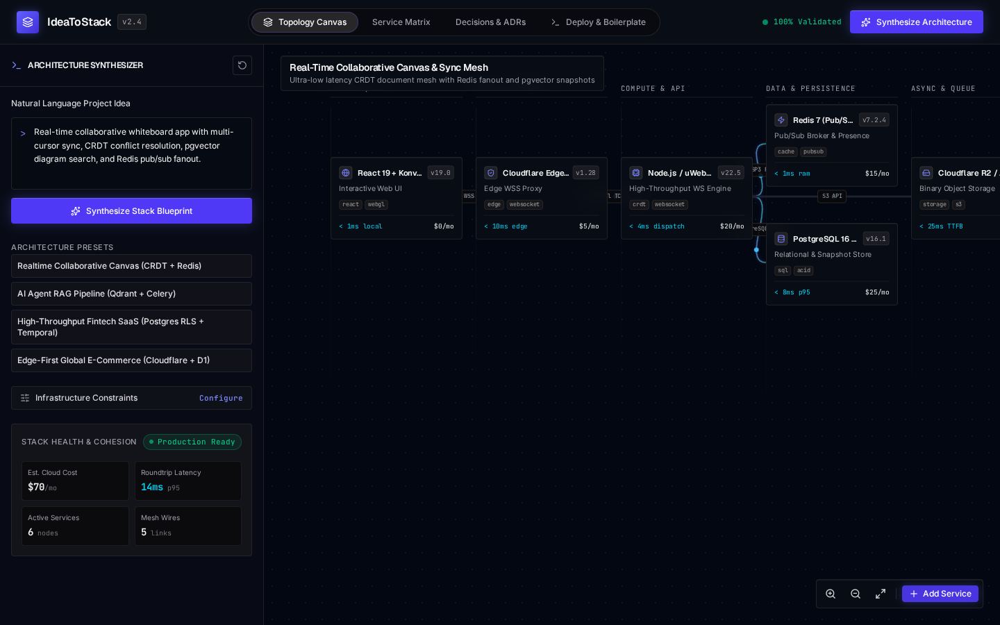
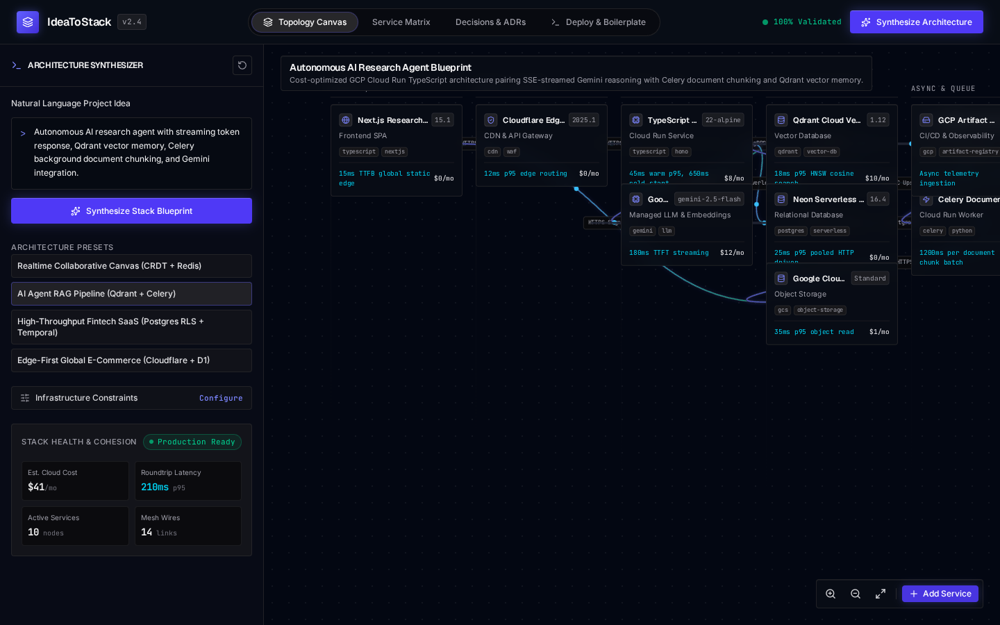
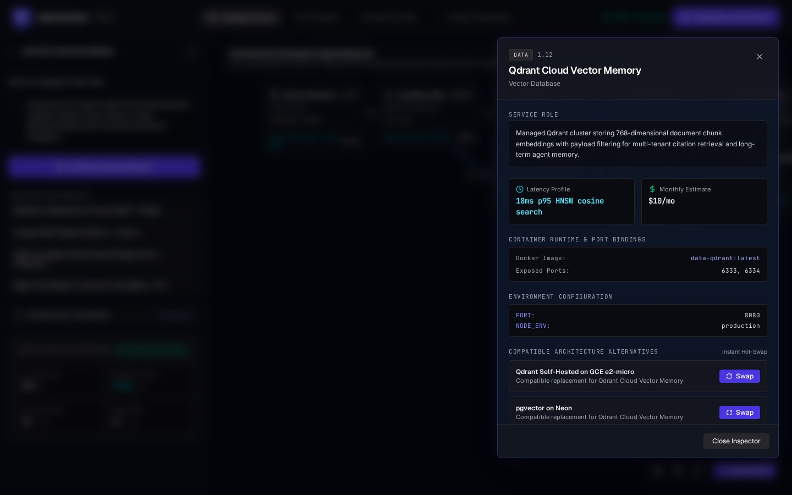
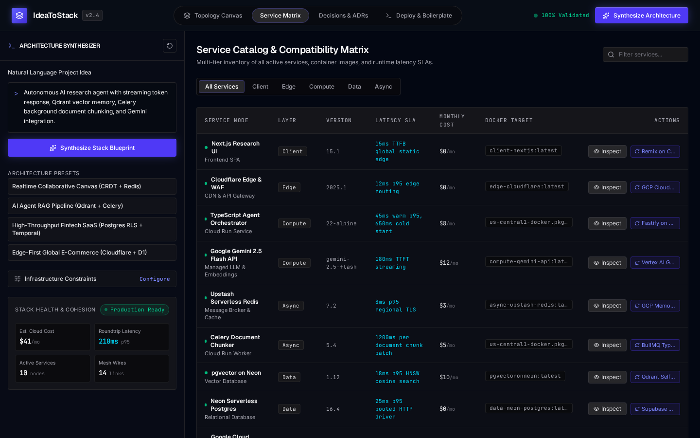
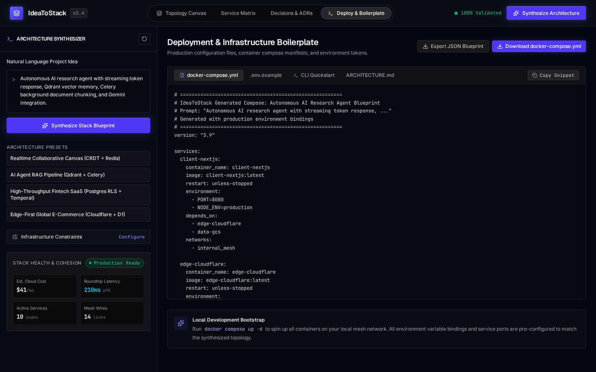
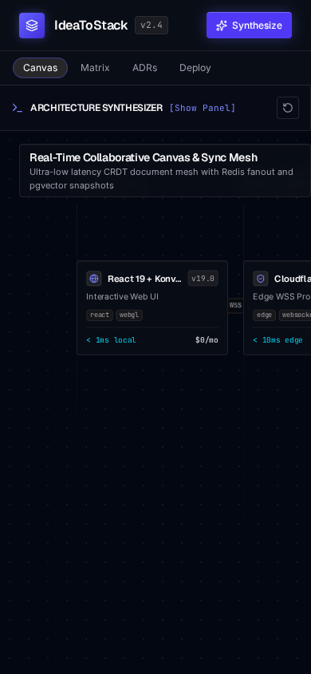
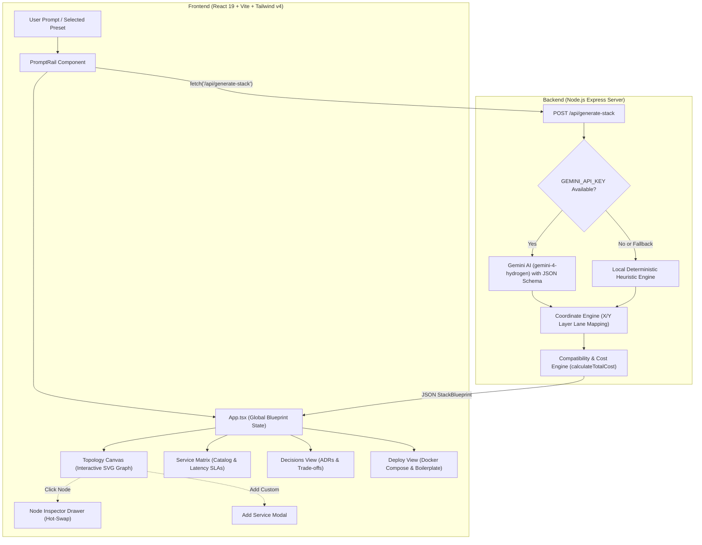
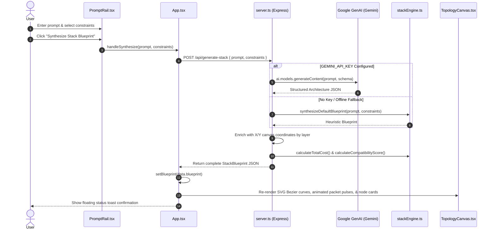
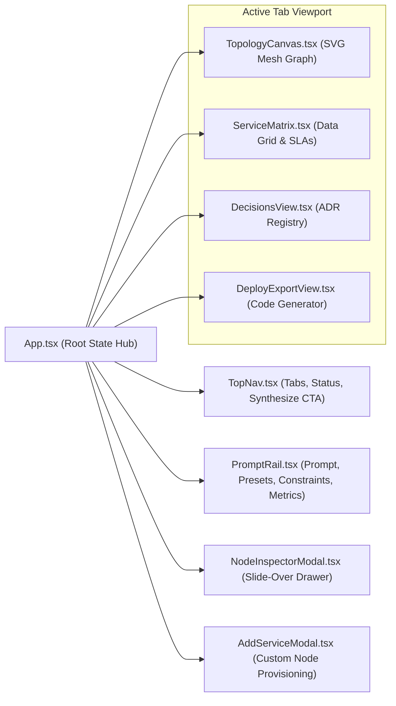

# IdeaToStack ⚡

> **High-velocity developer infrastructure engine that turns natural language ideas into production-ready architecture blueprints, interactive topology graphs, and deployment stacks.**

[](#testing)
[](https://react.dev/)
[](https://vite.dev/)
[](https://tailwindcss.com/)
[](https://nodejs.org/)
[](LICENSE)

---

## 📸 Overview & Visuals

| Real-Time Collaborative Canvas | Autonomous AI Research Agent |
| :---: | :---: |
|  |  |

| Slide-Over Node Inspector | Multi-Tier Service Matrix |
| :---: | :---: |
|  |  |

| Deployment & Boilerplate Center | Responsive Mobile Experience |
| :---: | :---: |
|  |  |

---

## 🚀 Key Features

* **Natural Language Architecture Synthesis**: Transform product ideas into complete, multi-tiered infrastructure blueprints using Google Gemini (`gemini-4-hydrogen` with strict JSON schema) or an instant, zero-dependency local heuristic engine.
* **Interactive Topology Canvas**:
  * Visual lane guides: `Client / UI`, `Edge & Security`, `Compute & API`, `Data & Persistence`, and `Async & Queue`.
  * Cubic Bezier SVG wiring with protocol tags (`HTTPS / SSE`, `gRPC`, `RESP3`, `PostgreSQL Wire`, `S3 API`).
  * Live animated packet throughput pulses (`<animateMotion>`).
  * Pan and zoom controls with auto-fit viewport reset.
* **Instant Service Hot-Swapping**: Substitute any node with a compatible alternative (e.g. *Qdrant Cloud* $\rightarrow$ *pgvector on Neon*). The engine dynamically updates exposed ports, Docker images, environment variables, monthly costs, and network links.
* **Service Catalog & Compatibility Matrix**:
  * Searchable and filterable data grid for all active services.
  * Real-time latency SLA monitoring and container target badges.
  * Quick-inspect and one-click alternative swapping.
* **Formalized Architecture Decision Records (ADRs)**:
  * Document technical context, architectural choices, consequences, and evaluated alternatives.
  * Interactive form to append new ADRs to the stack specification.
* **Turnkey Deployment Deliverables**:
  * Production `docker-compose.yml` with container names, isolated bridge networks (`internal_mesh`), and topological `depends_on` dependencies.
  * Annotated `.env.example` file aggregating environment tokens across all services.
  * CLI quickstart bootstrap commands.
  * Full `ARCHITECTURE.md` design document and downloadable JSON blueprints.
* **Multi-Theme Engine & Settings Modal**:
  * **Midnight Void (`dark`)**: Technical minimalism with dark glassmorphism & electric indigo accents (default).
  * **Technical Crisp (`light`)**: High-contrast, clean daylight architectural aesthetic with slate borders & crisp readability.
  * **Crimson Velocity (`red`)**: High-energy, hyper-focused motivational red theme with fiery glowing borders, live developer momentum ticker, and theme-synchronized SVG wire & packet pulses.
  * Persistent storage in `localStorage` with zero layout shift or flash.
* **Modern Developer Aesthetic**: Engineered with dark glassmorphism, dot-grid canvas textures, hairline borders, and Geist / Inter / JetBrains Mono typography.

---

## 🛠️ System Architecture & How It Works

### High-Level System Architecture Flow



### End-to-End Synthesis Sequence



### Frontend State & Component Hierarchy



---

## 🧩 Architectural Presets

IdeaToStack includes pre-calculated, deterministic baseline profiles that mirror reference infrastructure patterns:

| Preset Profile | Target Stack | Cost | Latency | Nodes / Links |
| :--- | :--- | :---: | :---: | :---: |
| **Realtime Collaborative Canvas** | React 19 + Konva, Envoy, uWebSockets, Redis 7 Pub/Sub, PostgreSQL 16 + pgvector, Cloudflare R2 | **$70/mo** | **14ms** p95 | 6 nodes / 5 links |
| **Autonomous AI Research Agent** | Next.js 15, Cloudflare WAF, TypeScript Hono, Gemini 2.5 Flash, Qdrant Cloud, Neon Postgres, GCS, Upstash Redis, Celery Workers, GCP Artifact Registry | **$41/mo** | **210ms** p95 | 10 nodes / 14 links |
| **High-Throughput Fintech SaaS** | React 19, Cloudflare Edge, Go Fiber API, PostgreSQL 16 with Row-Level Security (RLS), Dragonfly Cache, Temporal.io Durable Workflows | **$70/mo** | **22ms** p95 | 6 nodes / 5 links |
| **Edge-First Global E-Commerce** | Cloudflare Pages + Astro, Cloudflare WAF, Workers Checkout API, Cloudflare D1 SQL, Queues Fraud Worker, R2 Media Store | **$35/mo** | **12ms** p95 | 6 nodes / 6 links |

---

## 📁 Project Directory Structure

```
IdeaToStack/
├── .env.example                         # Environment template (GEMINI_API_KEY, APP_URL)
├── .gitignore                           # Git ignore specifications
├── index.html                           # HTML entry with font imports (Geist, Inter, JetBrains Mono)
├── metadata.json                        # Applet metadata & capability declarations
├── package.json                         # Scripts & dependency definitions
├── README.md                            # Complete project documentation
├── server.ts                            # Express backend + Gemini API endpoint + Vite middleware
├── tsconfig.json                        # TypeScript compiler configuration
├── vite.config.ts                       # Vite bundler configuration with Tailwind v4 & React
│
├── Artifacts/                           # UI reference screenshots and design documentation
│   ├── r1-desktop.png
│   ├── r2-synthesized-canvas.png
│   ├── r3-node-inspector.png
│   ├── r4-service-matrix.png
│   ├── r5-deploy-export.png
│   ├── r6-mobile.png
│   └── r7-mobile-clean.png
│
├── public/assets/aistudio/
│   └── Image_7_fc42469c.markdown        # Comprehensive design system tokens & color specifications
│
└── src/
    ├── App.tsx                          # Root React component managing state, tabs, & modals
    ├── index.css                        # Tailwind v4 theme, glassmorphic surface tiers, & dot-grids
    ├── main.tsx                         # React 19 application mount
    │
    ├── components/
    │   ├── AddServiceModal.tsx          # Modal for provisioning custom nodes or common presets
    │   ├── DecisionsView.tsx            # Architecture Decision Records (ADRs) management
    │   ├── DeployExportView.tsx         # Multi-tab export center (docker-compose, .env, CLI)
    │   ├── NodeInspectorModal.tsx       # Slide-over drawer with metrics, ports, & hot-swap
    │   ├── PromptRail.tsx               # Collapsible sidebar for prompt, presets, & constraints
    │   ├── ServiceMatrix.tsx            # Data catalog table with SLAs and docker targets
    │   ├── TopNav.tsx                   # 3-zone header with navigation tabs and status
    │   └── TopologyCanvas.tsx           # SVG pan/zoom graph with animated packet pulses
    │
    └── utils/
        ├── stackEngine.ts               # Core domain engine (scoring, synthesis, docker generation)
        └── stackEngine.test.ts          # Automated unit test suite (6/6 passing)
```

---

## ⚡ Getting Started

### Prerequisites

* **Node.js**: `v20.0.0` or higher (tested on `v22.23.1`)
* **npm**: `v10.0.0` or higher

### 1. Installation

Clone the repository and install dependencies:

```bash
git clone https://github.com/your-username/IdeaToStack.git
cd IdeaToStack
npm install --legacy-peer-deps
```

### 2. Environment Setup (Optional)

Copy `.env.example` to `.env`:

```bash
cp .env.example .env
```

If you wish to enable server-side Gemini AI synthesis, provide your API key in `.env`:

```env
GEMINI_API_KEY="your-google-gemini-api-key"
PORT=3000
```

> **Note**: Even without an API key, IdeaToStack is **100% operational** using its built-in deterministic heuristic architecture engine.

### 3. Run Development Server

Start the application (Express backend embedding Vite dev middleware):

```bash
npm run dev
```

Open your browser at:
```
http://localhost:3000
```

### 4. Build for Production

Compile the production bundle and preview it:

```bash
npm run build
npm start
```


---

## 🧪 Testing

IdeaToStack features a comprehensive unit test suite powered by Node.js's native test runner (`node:test` and `node:assert/strict`), validating the core domain logic in [src/utils/stackEngine.test.ts](src/utils/stackEngine.test.ts):

```bash
npm test
```

### Test Suite Output

```
✔ calculateTotalCost sums monthly expenses correctly
✔ calculateCompatibilityScore scores balanced production stack at 100
✔ calculateCompatibilityScore flags missing layers and dangling connections
✔ generateDockerCompose produces valid yaml syntax and depends_on blocks
✔ generateEnvExample extracts all service env variables
✔ swapService cleanly replaces target node and remaps connections

1..6
# tests 6
# pass 6
# fail 0
```

---

## 🌐 API Reference

### Health Check

```http
GET /api/health
```

**Response:**
```json
{
  "status": "healthy",
  "geminiConfigured": true,
  "timestamp": "2026-11-15T00:00:00.000Z"
}
```

### Synthesize Stack Blueprint

```http
POST /api/generate-stack
Content-Type: application/json

{
  "prompt": "Autonomous AI research agent with streaming token response, Qdrant vector memory, and Celery chunking.",
  "constraints": {
    "hosting": "Cloud Run / GCP",
    "language": "TypeScript",
    "budgetTier": "Cost-Optimized (<$50/mo)",
    "scalability": "Growth (1k-100k users)"
  }
}
```

**Response:**
```json
{
  "blueprint": {
    "id": "stack-ai-rag-agent",
    "title": "Autonomous AI Research Agent Blueprint",
    "tagline": "Cost-optimized GCP Cloud Run TypeScript architecture pairing SSE-streamed Gemini reasoning...",
    "totalMonthlyCost": 41,
    "compatibilityScore": 100,
    "validationStatus": "Production Ready",
    "estimatedLatencyMs": 210,
    "services": [...],
    "connections": [...],
    "decisions": [...]
  },
  "source": "gemini-4-hydrogen"
}
```

---

## 📄 License

Distributed under the Apache 2.0 License. See [LICENSE](LICENSE) for more details.

